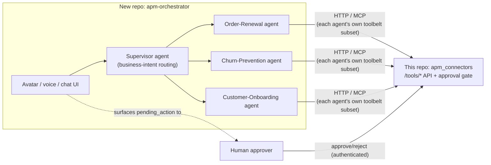

# Roadmap: avatar, multi-agent, scale, security

This repo (connectors + the approval gate) stays as-is: a plain,
auditable HTTP API with no reasoning of its own, per `CLAUDE.md`. This
doc tracks the plan for the layer that sits on top of it — a separate
repo that owns reasoning, orchestration, and the human-facing
interface — plus the production-hardening work that applies to this
repo itself. Nothing here changes this repo's contract; it's the map
of what calls into it next.

## Why a second repo, not four

An avatar (visual/voice interface) and a multi-agent supervisor system
are one presentation layer over one reasoning layer, not two
concerns — the avatar is just the human-facing surface of the
Supervisor agent. They belong in one new repo (call it
`apm-orchestrator` below; naming TBD), separate from this one:

Splitting further later (e.g. avatar streaming media as its own
service) is easy once there's a reason — a shared media/SFU workload
that needs to scale independently of agent logic is the likely trigger.
Don't pre-split before that need shows up.

**Agents are decomposed by business process, not by connector.** The
tempting default is one agent per external system (an "Email agent," a
"Calendar agent"), mirroring this repo's own per-connector modules. Don't
do that — it just relocates the same tool-plumbing without adding
business logic, and pushes all *actual* workflow knowledge (SLA windows,
what blocks a renewal, escalation rules) up into the Supervisor, which
then has to know every business process anyway. Instead, each specialized
agent owns one end-to-end business capability (Order Renewal, Churn
Prevention, Customer Onboarding, ...) and is handed whatever subset of
this repo's connector tools that process actually needs — an
Order-Renewal agent's toolbelt might be `salesforce.query`,
`salesforce.update`, `jira.search` (checking for blocking tickets),
`calendar.create_event`, and `gmail.send`, all called from inside that
one agent's own run, not fanned out across four separate agent hops.
This also makes least-privilege scoping map to something real: "the
Renewals agent can touch Opportunity records and send renewal mail," not
"this agent can call the Salesforce API." New business capabilities get
onboarded as new agents over time — a product roadmap, not a connector
roadmap. The one thing to watch: two business agents can propose
conflicting writes to the same underlying record (e.g. Renewals and a
Support agent both touching the same Opportunity) — this repo's single
approval queue and audit log already catch that, since every proposed
write from any business agent lands there regardless of which agent
proposed it.

**The approval boundary never moves.** The avatar/Supervisor can
*propose* and can *display* a pending action to a human, but the
decision that unblocks `execute_node` must still be a real
`POST /tools/actions/{id}/decision` from an authenticated human,
exactly as today. This holds regardless of how sophisticated the
orchestration layer gets — see `docs/security-guardrails.md`.

## Phase 0 — harden this repo's seam first (blocking)

Before any external repo/avatar/real users call this API in
production, close the gap `docs/api-contract.md` already documents:
**"No auth today."**

- **Done:** an API-key check (`APM_API_KEYS`, opt-in — see
  `docs/api-contract.md`) in front of every `/tools/*` and
  `/processes/*` route (`require_caller` in `api/dependencies.py`),
  wired into the ECS Terraform module as an SSM secret the same way
  `database_url` is.
- **Done:** the audit log (`StateStoreProtocol`) now records *which*
  authenticated caller proposed an action (`proposed_by`) and *which*
  authenticated human decided it (`decided_by`), as two independent
  identities — both `null` with auth off.
- **Done:** every read (`gmail_search`, `salesforce_query`, etc.) is
  attributed too, as the audit event's `caller` field — `BaseTool._log`
  and every connector's read methods now take an optional `caller`,
  threaded from `require_caller` through each `/tools/*` read route.
  Closes the gap the first version of this bullet left open.
- **Done:** a general Drive documents connector (`drive_tool.py`) —
  list/search files, download/read a file, upload/update a file,
  scoped to one configured folder (`APM_DRIVE_FOLDER_ID`) — following
  the `tool-integration` skill checklist (`BaseTool` interface,
  `dry_run`, approval-gated writes, capability-map entry). The
  Excel-on-Drive connector (`excel_file_tool.py`) still only reads/writes
  cell ranges in one `.xlsx` workbook; this is the separate connector
  for arbitrary documents (contracts, POs, signed agreements) — every
  business agent
  will want that, not just the Order-Renewal pilot.
- Everything below assumes this is done first.

## Phase 1 — multi-agent core (new repo)

- Supervisor agent (Claude Agent SDK) that does business-intent routing
  (e.g. "this is a renewal" / "this is a churn signal"), not
  connector routing.
- Specialized agents, one per business process/capability (e.g. Order
  Renewal, Churn Prevention, Customer Onboarding — start with whichever
  one process is the highest-value pilot), each holding a scoped subset
  of this repo's connector tools as its own toolbelt. See "Agents are
  decomposed by business process, not by connector" above.
- Each specialized agent talks to this repo only via
  `apm_connectors_mcp` (or direct HTTP against `/tools/*`) — never
  imports this repo's internals, same boundary this repo already keeps
  with its own MCP server.
- Shared task/conversation state (Postgres) so the Supervisor can track
  multi-step plans across agents.

### Pilot: Order-Renewal agent

Chosen as the first business agent — generic enough in shape (detect →
verify → act → record) to be the template every later business agent
copies. Its toolbelt, using this repo's actual connector methods:

| Step | Tool | Calls | Gate |
|---|---|---|---|
| Detect a renewal/complaint/escalation signal | Gmail | `search_emails`, `read_message` | read |
| Look up the account/opportunity | Salesforce | `query_records`, `get_record` | read |
| Check for blocking tickets | Jira | `search_issues`, `get_issue` | read |
| Pull the existing contract/agreement | Drive *(new connector, see Phase 0)* | `list_files`/`search_files`, `read_file` | read |
| Propose a renewal call | Calendar | `create_event` | **approval** |
| Send the renewal notice/confirmation | Gmail | `send_email` | **approval** |
| Store the finalized renewal document | Drive *(new)* | `upload_file`/`update_file` | **approval** |
| Route follow-up work to a team/partner | Jira | `create_issue` (targeted at that team/partner's actual Jira project/component — "work areas" means a Jira project, not an ad hoc issue) | **approval** |
| Update the record of truth | Salesforce | `update_record` (stage, close date) | **approval** |
| Reporting (separate cadence, not the live workflow) | Excel | `write_range`, generated *from* Salesforce state on a schedule | **approval**, lower-stakes than the rest |

**Salesforce is the system of record for order/renewal state, not
Excel.** Excel's `write_range` is a single shared workbook with no
row-level concurrency control (capability-map: "one workbook per
running server") — fine for a generated report, unsafe as a second
place live order state gets written during the workflow. Two systems
both claiming to hold the live record is how they silently drift; this
repo's approval queue only catches conflicting writes *within* one
system, not across two.

The policy that makes this "a renewal" (which Gmail/SOQL/JQL filters,
SLA windows, what counts as a blocker) should live as config the agent
reads, not code — so the next business agent (Churn Prevention, say) is
a new policy + a different toolbelt subset, not new plumbing.

## Phase 2 — avatar interface (new repo)

- Voice: STT + TTS in front of the Supervisor.
- Visual avatar: start with a lip-synced 2D avatar or a hosted
  talking-head API (e.g. D-ID/Simli) — treat a full 3D/photoreal avatar
  as a later bet, not an MVP requirement.
- Pending-action review surfaced in the same UI, routed to this repo's
  decision endpoint under the authenticated human's own identity
  (Phase 0 dependency).

## Phase 3 — production scalability

**This repo:**
- **Done:** the Postgres-backed state store and LangGraph checkpointer
  (`DATABASE_URL`) are now required, not optional, to run the API
  server at all — no file-backed/in-memory fallback (see
  `docs/deployment.md`, `api/dependencies.py`'s `_require_database_url`).
- ECS service auto-scaling (target tracking on CPU/request count) —
  the Postgres-backed checkpointer already makes this safe across
  multiple tasks.
- HTTPS (ACM + domain) in front of the ALB — currently HTTP-only per
  `docs/deployment.md`.
- Per-external-system rate limiting/backpressure (Gmail, Salesforce,
  Jira all have their own quotas this API doesn't currently shield
  itself from).
- **Observability (not started, either repo — audited 2026-09-22).**
  What exists today is an audit trail, not observability: this repo's
  `StateStoreProtocol` records who proposed/decided each action
  (Phase 0, above) and is well covered by
  `tests/test_state_store.py`/`test_postgres_state_store.py`, but
  neither repo has structured application logging, a `/metrics`
  endpoint, or any tracing integration. `apm_orchestrator` uses
  `logging` in only 2 of ~10 source files; everywhere else (including
  its CLI entry point) is bare `print()`, none of it asserted on by any
  test. Retrofitting this after ECS autoscaling (above) is live is
  harder than building it in now — scope before the rest of this phase
  starts:
  - Structured logging (replace `print()` calls; consistent fields —
    request id, caller, latency — across both repos).
  - A `/metrics` endpoint (this repo already has a real `/health`
    endpoint to extend the pattern from) and a tracing integration
    (e.g. OpenTelemetry — currently only present as a transitive
    dependency via `langsmith`/`langchain-core`, not initialized by
    either repo's own code).
  - Dashboards/alerting on top of whichever metrics backend is chosen.

**New repo:**
- Scale the Supervisor and specialized agents independently (queue-based
  fan-out, e.g. SQS/NATS between them) rather than one monolith process.
- Avatar media/streaming on a managed WebRTC/SFU provider (e.g. LiveKit,
  Daily) rather than self-hosting — this workload scales per concurrent
  session, differently from agent compute.
- Session/turn state in Redis for the avatar's real-time loop.

## Phase 4 — security hardening

- mTLS or OIDC between avatar ↔ Supervisor ↔ this repo's API — no
  layer trusts caller identity by network position alone.
- Prompt-injection defenses at every agent handoff: a specialized
  agent's output is untrusted input to the Supervisor, same as this
  repo already treats a caller's proposed action as needing the
  guardrails in `docs/security-guardrails.md` (e.g. the
  reserved-domain refusal in `GmailTool.send_email`).
- PII/consent policy for voice/video capture and retention.
- Per-tenant/user scoping if more than one business/user shares a
  deployment.
- Independent security review before any real customer data flows
  through the avatar end to end.

## Phase 5 — end-to-end business testing

- **Agent evaluation (`apm_orchestrator`) — already ahead of this
  phase (audited 2026-09-22).** Built as part of the Supervisor
  confidence feature, ahead of any phase formally tracking it:
  - **Done:** a versioned golden dataset
    (`src/apm_orchestrator/evals/routing_cases.py`, four categories —
    clear/adversarial/out_of_scope/ambiguous) and an eval harness
    (`run_supervisor_routing_eval.py`) run against the real Claude API,
    checking both delegate choice and confidence-vs-category. Turned
    into individually-named, hard pytest assertions
    (`tests/test_supervisor_routing_eval.py`), gated behind
    `ANTHROPIC_API_KEY`, and run on a nightly schedule +
    manual-dispatch CI job (`.github/workflows/eval.yml`) separate from
    the fast/default test run (it makes ~20 real paid API calls).
  - **Done:** ground-truth calibration tracking on top of the golden
    dataset — the golden dataset only proves the model agrees with the
    dataset author's own labels; `SupervisorRoutingLog.reviewed_correct`
    (sampled via `scripts/review_routing_log.py`, reported via
    `scripts/calibration_report.py`) proves whether "low" confidence
    actually predicts a wrong routing on real traffic, which is the
    claim that matters.
  - **Gap:** the golden-dataset eval only runs nightly/on-demand, never
    on a PR — a routing regression can sit undetected on `main` for up
    to 24 hours. Consider a lighter, PR-gated subset of the golden
    dataset once API cost allows.
  - **Not applicable to this repo:** `apm_connectors` has no evaluation
    harness by design — it's reasoning-free (per its own `CLAUDE.md`),
    so there's no model behavior to evaluate here; noted so the
    asymmetry between the repos reads as deliberate, not an oversight.
- Golden-path workflows run against sandbox tenants (a real Gmail test
  account, Salesforce/Jira sandboxes) with real human approvals, not
  just `dry_run=True`.
- Load testing: concurrent avatar sessions, Supervisor fan-out under
  load, this API's throughput against external providers' own rate
  limits.
- Chaos testing: kill an ECS task mid-approval (already live-verified
  for this repo per `docs/deployment.md`), kill a specialized agent
  mid-task, simulate a network partition between the orchestrator and
  this API.
- Pilot UAT with real business users on one full workflow (e.g.
  inbound support email → drafted reply → calendar check → scheduled
  call → CRM update) before wider rollout.

## Phase 6 — future builds: intelligent document processing + A2A

**Status: 6.1 + 6.3 first slice built in `apm_orchestrator`
(2026-11-05); 6.2, 6.4 and the Gmail attachment route not started.**
Two capabilities this phase adds: *intelligent document processing*
(IDP — reading a PO, contract, or onboarding pack and extracting
structured, confidence-scored fields) and *agent-to-agent* (A2A)
interoperability (an agent with its own reasoning, possibly owned by
another team or vendor, called as a peer rather than as a tool).

What the first slice covers (see `apm_orchestrator`'s README, "Purchase-
order intake"): the document-extraction agent as a real A2A server
(official `a2a-sdk`, Agent Card, `input-required` review loop, optional
bearer auth); Order-Renewal PO intake from Drive with reconciliation
and approval-gated Salesforce-update / Jira-ticket proposals; and an
8-case synthetic golden set with per-field scoring and a calibration
report, run nightly. Not yet done: a live eval run against the real
model and a live end-to-end run against real Drive/Salesforce/Jira,
durable A2A task storage (tasks, including the document, live in the
agent's memory today), and the email-in path. No change to this repo
was needed — PO intake uses the existing `/tools/drive/read`,
`/tools/salesforce/update` and `/tools/jira/create` routes.

**Where each piece lives — the split doesn't move.** Document
*extraction* is reasoning, so it belongs in `apm_orchestrator` (or a
new A2A service alongside it), never in this repo. This repo's only
part is reading the raw bytes (Drive already does, Gmail attachments
would be new) and gating whatever write the extraction leads to. Every
write that results from a document — from any agent, internal or
external — still lands in this repo's approval queue and audit log.

**MCP vs A2A, as this project uses them.** This repo's `/tools/*` API
(and `apm_connectors_mcp`) is *agent-to-tool*: deterministic, no
reasoning, every write approval-gated. A2A is *agent-to-agent*: the
callee is itself a reasoning agent that publishes an Agent Card,
accepts tasks, and returns task artifacts. A2A is for a specialist
agent; an external system with no reasoning of its own stays an MCP/HTTP
tool here.

### 6.1 IDP — purchase-order intake (Order-Renewal agent)

A customer emails a PO or signed renewal quote as a PDF, or it is
dropped in the configured Drive folder (`APM_DRIVE_FOLDER_ID`).

1. Read the document — `POST /tools/drive/read` (exists, returns
   `content_base64`), or a new Gmail attachment read route (below).
2. Extract account name, PO number, amount, currency, term start/end,
   and signatory — **each with a per-field confidence score**.
3. Reconcile against the Salesforce Opportunity the renewal case already
   selects (`verify_account_node`'s normalized-name match and
   `_closest_to_today` pick, per `apm_orchestrator`'s `CLAUDE.md` —
   never an exact-string or `records[0]` shortcut).
4. Match → propose `salesforce_update` (PO number, stage). Mismatch or
   low-confidence field → propose `jira_create_issue` for a human to
   reconcile. Both go through the approval gate as usual.

Tolerances (amount delta, date drift) and the confidence threshold that
routes a field to human review are `policy.yaml` data, not code.

**This repo's piece:** a read-only Gmail attachment route — e.g.
`POST /tools/gmail/attachments/list` (`{message_id}` → `[{attachment_id,
filename, mime_type, size}]`) and `POST /tools/gmail/attachments/read`
(`{message_id, attachment_id}` → `{filename, mime_type, size,
content_base64}`). Additive (no existing route's shape changes), built
via the `tool-integration` skill, registered in
`docs/capability-map.md` and `docs/api-contract.md`. Needs a size cap
and MIME allowlist (PDF, images, `.docx`) so an arbitrary attachment
can't be pulled through.

**Evaluation (`apm_orchestrator`):** a versioned golden set of sample
POs (synthetic, no real customer data) with hand-labelled field values,
scored per field — exact match for PO number, tolerance for amounts and
dates. Same shape as the routing eval
(`evals/routing_cases.py` + nightly `eval.yml`), and the same
calibration idea as `SupervisorRoutingLog.reviewed_correct`: record a
reviewer's verdict on extracted fields so "low confidence" can be shown
to actually predict a wrong field on real documents.

### 6.2 IDP — onboarding document pack (Customer-Onboarding agent)

Extract and check an onboarding/KYC-style pack: certificate of
incorporation, proof of address, signed contract, director IDs.

- A checklist in `customer_onboarding/policy.yaml`: which documents are
  required, maximum document age/expiry, and which extracted names must
  match the Salesforce Account/Contact (normalized-name match, same rule
  as Order-Renewal).
- Missing, expired, or mismatched document → propose a request email
  (`gmail_send`) listing exactly what's needed; approval-gated.
- Complete pack → continue the existing onboarding case graph
  (kickoff call, welcome notice, ticket, record update).
- Identity documents are high-sensitivity PII: extracted values are
  stored minimally (pass/fail + reference, not full ID numbers) and
  covered by Phase 4's PII/retention policy before any real pack is
  processed.

### 6.3 A2A — document extraction as its own agent

Split 6.1/6.2's extraction out of each business agent into a standalone
**document-extraction agent** exposed over A2A, which Order-Renewal and
Customer-Onboarding both call instead of extracting in-process.

- Publishes an **Agent Card** (skills: `extract_purchase_order`,
  `extract_onboarding_pack`; input/output schemas; auth requirements).
- Accepts a task with the document bytes (fetched by the *calling*
  agent from this repo's read routes — the extraction agent gets no
  connector credentials of its own) and returns extracted fields +
  per-field confidence as **task artifacts**.
- Low-confidence extraction → the A2A task moves to **`input-required`**,
  which the calling case graph treats as a human-review checkpoint
  (a LangGraph interrupt, like `wait_for_approval`) — distinct from, and
  never a substitute for, this repo's write-approval gate.
- Owns the golden-set eval from 6.1, so extraction quality is measured
  once, not per business agent.
- Lives in `apm_orchestrator` (e.g. `src/apm_orchestrator/a2a/`) or a
  third repo/service if it needs to scale or ship independently — decide
  when building it, not before.

### 6.4 A2A — third-party agent behind the approval gate

An external agent (e.g. a vendor's credit-check or sanctions-screening
agent) connected over A2A.

- It may **propose**; it can **never approve**. Its proposals reach this
  repo only through an orchestrator agent's normal write routes, under
  its own API key/identity (so `proposed_by` names it in the audit log),
  and the decision route stays human-only per `CLAUDE.md` in both repos.
- Everything it returns is **untrusted input** — schema-validated, never
  concatenated into a prompt as instructions — per Phase 4's
  prompt-injection defenses at every agent handoff.
- Every A2A exchange (task sent, artifacts received, state transitions)
  is audit-logged alongside the connector events, with the remote
  agent's identity.
- Depends on Phase 4's mTLS/OIDC work: no external agent is trusted by
  network position.

### Suggested build order

1. **6.3 + 6.1 together** (first build): the A2A extraction agent, called
   by Order-Renewal for PO reconciliation, plus the golden-set eval.
   Uses connectors that already exist (Drive read, Salesforce, Jira); the
   Gmail attachment route is optional for this first slice.
2. **Gmail attachment read route** in this repo, for the email-in path.
3. **6.2**, reusing the extraction agent with a new skill.
4. **6.4**, once Phase 4's auth and injection defenses are in place.

## Rough timeline

Assuming a small team (2-4 engineers) and phases 1-4 overlapping
rather than strictly sequential: **~14-16 weeks (3.5-4 months)** to a
real production v1 across both repos. Phase 0 is a hard blocker and
should land in the first 1-2 weeks.
