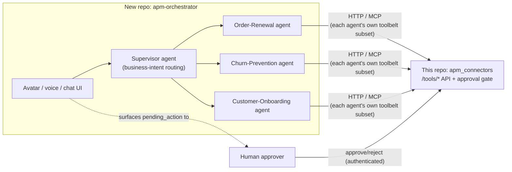
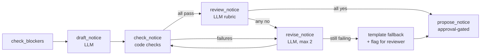

# Roadmap: avatar, multi-agent, scale, security

This repo (connectors + the approval gate) stays as-is: a plain,
auditable HTTP API with no reasoning of its own, per `CLAUDE.md`. This
doc tracks the plan for the layer that sits on top of it — a separate
repo that owns reasoning, orchestration, and the human-facing
interface — plus the production-hardening work that applies to this
repo itself. Nothing here changes this repo's contract; it's the map
of what calls into it next.

## Why a second repo, not four

An avatar (visual/voice interface) and a multi-agent supervisor system
are one presentation layer over one reasoning layer, not two
concerns — the avatar is just the human-facing surface of the
Supervisor agent. They belong in one new repo (call it
`apm-orchestrator` below; naming TBD), separate from this one:

Splitting further later (e.g. avatar streaming media as its own
service) is easy once there's a reason — a shared media/SFU workload
that needs to scale independently of agent logic is the likely trigger.
Don't pre-split before that need shows up.

**Agents are decomposed by business process, not by connector.** The
tempting default is one agent per external system (an "Email agent," a
"Calendar agent"), mirroring this repo's own per-connector modules. Don't
do that — it just relocates the same tool-plumbing without adding
business logic, and pushes all *actual* workflow knowledge (SLA windows,
what blocks a renewal, escalation rules) up into the Supervisor, which
then has to know every business process anyway. Instead, each specialized
agent owns one end-to-end business capability (Order Renewal, Churn
Prevention, Customer Onboarding, ...) and is handed whatever subset of
this repo's connector tools that process actually needs — an
Order-Renewal agent's toolbelt might be `salesforce.query`,
`salesforce.update`, `jira.search` (checking for blocking tickets),
`calendar.create_event`, and `gmail.send`, all called from inside that
one agent's own run, not fanned out across four separate agent hops.
This also makes least-privilege scoping map to something real: "the
Renewals agent can touch Opportunity records and send renewal mail," not
"this agent can call the Salesforce API." New business capabilities get
onboarded as new agents over time — a product roadmap, not a connector
roadmap. The one thing to watch: two business agents can propose
conflicting writes to the same underlying record (e.g. Renewals and a
Support agent both touching the same Opportunity) — this repo's single
approval queue and audit log already catch that, since every proposed
write from any business agent lands there regardless of which agent
proposed it.

**The approval boundary never moves.** The avatar/Supervisor can
*propose* and can *display* a pending action to a human, but the
decision that unblocks `execute_node` must still be a real
`POST /tools/actions/{id}/decision` from an authenticated human,
exactly as today. This holds regardless of how sophisticated the
orchestration layer gets — see `docs/security-guardrails.md`.

**Retrieval/knowledge stays out of this repo.** A retrieval index
over documents (and any "knowledge agent" answering questions from it)
belongs in `apm_orchestrator`
(`KNOWLEDGE_AGENT_AND_RETRIEVAL_INDEX.md` there), not here. An index
persists document text, which `docs/security-guardrails.md` §3 rules
out for this repo. It also needs embedding and ranking model calls,
and this repo makes none. It's also a derived copy that can go stale,
unlike this repo's live reads from the system of record. This repo's
role stays the same: its existing `/tools/drive/list` and
`/tools/drive/read` read routes are how the orchestrator's indexer
fetches source documents, audited like any other read. Give the
indexer its own `APM_API_KEYS` entry so its reads are attributed
separately.

## Phase 0 — harden this repo's seam first (blocking)

Before any external repo/avatar/real users call this API in
production, close the gap `docs/api-contract.md` already documents:
**"No auth today."**

- **Done:** an API-key check (`APM_API_KEYS`, opt-in — see
  `docs/api-contract.md`) in front of every `/tools/*` and
  `/processes/*` route (`require_caller` in `api/dependencies.py`),
  wired into the ECS Terraform module as an SSM secret the same way
  `database_url` is.
- **Done:** the audit log (`StateStoreProtocol`) now records *which*
  authenticated caller proposed an action (`proposed_by`) and *which*
  authenticated human decided it (`decided_by`), as two independent
  identities — both `null` with auth off.
- **Done:** every read (`gmail_search`, `salesforce_query`, etc.) is
  attributed too, as the audit event's `caller` field — `BaseTool._log`
  and every connector's read methods now take an optional `caller`,
  threaded from `require_caller` through each `/tools/*` read route.
  Closes the gap the first version of this bullet left open.
- **Done:** a general Drive documents connector (`drive_tool.py`) —
  list/search files, download/read a file, upload/update a file,
  scoped to one configured folder (`APM_DRIVE_FOLDER_ID`) — following
  the `tool-integration` skill checklist (`BaseTool` interface,
  `dry_run`, approval-gated writes, capability-map entry). The
  Excel-on-Drive connector (`excel_file_tool.py`) still only reads/writes
  cell ranges in one `.xlsx` workbook; this is the separate connector
  for arbitrary documents (contracts, POs, signed agreements) — every
  business agent
  will want that, not just the Order-Renewal pilot.
- Everything below assumes this is done first.

## Phase 1 — multi-agent core (new repo)

- Supervisor agent (Claude Agent SDK) that does business-intent routing
  (e.g. "this is a renewal" / "this is a churn signal"), not
  connector routing.
- Specialized agents, one per business process/capability (e.g. Order
  Renewal, Churn Prevention, Customer Onboarding — start with whichever
  one process is the highest-value pilot), each holding a scoped subset
  of this repo's connector tools as its own toolbelt. See "Agents are
  decomposed by business process, not by connector" above.
- Each specialized agent talks to this repo only via
  `apm_connectors_mcp` (or direct HTTP against `/tools/*`) — never
  imports this repo's internals, same boundary this repo already keeps
  with its own MCP server.
- Shared task/conversation state (Postgres) so the Supervisor can track
  multi-step plans across agents.

### Pilot: Order-Renewal agent

Chosen as the first business agent — generic enough in shape (detect →
verify → act → record) to be the template every later business agent
copies. Its toolbelt, using this repo's actual connector methods:

| Step | Tool | Calls | Gate |
|---|---|---|---|
| Detect a renewal/complaint/escalation signal | Gmail | `search_emails`, `read_message` | read |
| Look up the account/opportunity | Salesforce | `query_records`, `get_record` | read |
| Check for blocking tickets | Jira | `search_issues`, `get_issue` | read |
| Pull the existing contract/agreement | Drive *(new connector, see Phase 0)* | `list_files`/`search_files`, `read_file` | read |
| Propose a renewal call | Calendar | `create_event` | **approval** |
| Send the renewal notice/confirmation | Gmail | `send_email` | **approval** |
| Store the finalized renewal document | Drive *(new)* | `upload_file`/`update_file` | **approval** |
| Route follow-up work to a team/partner | Jira | `create_issue` (targeted at that team/partner's actual Jira project/component — "work areas" means a Jira project, not an ad hoc issue) | **approval** |
| Update the record of truth | Salesforce | `update_record` (stage, close date) | **approval** |
| Reporting (separate cadence, not the live workflow) | Excel | `write_range`, generated *from* Salesforce state on a schedule | **approval**, lower-stakes than the rest |

**Salesforce is the system of record for order/renewal state, not
Excel.** Excel's `write_range` is a single shared workbook with no
row-level concurrency control (capability-map: "one workbook per
running server") — fine for a generated report, unsafe as a second
place live order state gets written during the workflow. Two systems
both claiming to hold the live record is how they silently drift; this
repo's approval queue only catches conflicting writes *within* one
system, not across two.

The policy that makes this "a renewal" (which Gmail/SOQL/JQL filters,
SLA windows, what counts as a blocker) should live as config the agent
reads, not code — so the next business agent (Churn Prevention, say) is
a new policy + a different toolbelt subset, not new plumbing.

## Phase 2 — avatar interface (new repo)

- Voice: STT + TTS in front of the Supervisor.
- Visual avatar: start with a lip-synced 2D avatar or a hosted
  talking-head API (e.g. D-ID/Simli) — treat a full 3D/photoreal avatar
  as a later bet, not an MVP requirement.
- Pending-action review surfaced in the same UI, routed to this repo's
  decision endpoint under the authenticated human's own identity
  (Phase 0 dependency).

## Phase 3 — production scalability

**This repo:**
- **Done:** the Postgres-backed state store and LangGraph checkpointer
  (`DATABASE_URL`) are now required, not optional, to run the API
  server at all — no file-backed/in-memory fallback (see
  `docs/deployment.md`, `api/dependencies.py`'s `_require_database_url`).
- ECS service auto-scaling (target tracking on CPU/request count) —
  the Postgres-backed checkpointer already makes this safe across
  multiple tasks.
- HTTPS (ACM + domain) in front of the ALB — currently HTTP-only per
  `docs/deployment.md`.
- Per-external-system rate limiting/backpressure (Gmail, Salesforce,
  Jira all have their own quotas this API doesn't currently shield
  itself from).
- **Observability (not started, either repo — audited 2026-09-22).**
  What exists today is an audit trail, not observability: this repo's
  `StateStoreProtocol` records who proposed/decided each action
  (Phase 0, above) and is well covered by
  `tests/test_state_store.py`/`test_postgres_state_store.py`, but
  neither repo has structured application logging, a `/metrics`
  endpoint, or any tracing integration. `apm_orchestrator` uses
  `logging` in only 2 of ~10 source files; everywhere else (including
  its CLI entry point) is bare `print()`, none of it asserted on by any
  test. Retrofitting this after ECS autoscaling (above) is live is
  harder than building it in now — scope before the rest of this phase
  starts:
  - Structured logging (replace `print()` calls; consistent fields —
    request id, caller, latency — across both repos).
  - A `/metrics` endpoint (this repo already has a real `/health`
    endpoint to extend the pattern from) and a tracing integration
    (e.g. OpenTelemetry — currently only present as a transitive
    dependency via `langsmith`/`langchain-core`, not initialized by
    either repo's own code).
  - Dashboards/alerting on top of whichever metrics backend is chosen.

**New repo:**
- Scale the Supervisor and specialized agents independently (queue-based
  fan-out, e.g. SQS/NATS between them) rather than one monolith process.
- Avatar media/streaming on a managed WebRTC/SFU provider (e.g. LiveKit,
  Daily) rather than self-hosting — this workload scales per concurrent
  session, differently from agent compute.
- Session/turn state in Redis for the avatar's real-time loop.

## Phase 4 — security hardening

- mTLS or OIDC between avatar ↔ Supervisor ↔ this repo's API — no
  layer trusts caller identity by network position alone.
- Prompt-injection defenses at every agent handoff: a specialized
  agent's output is untrusted input to the Supervisor, same as this
  repo already treats a caller's proposed action as needing the
  guardrails in `docs/security-guardrails.md` (e.g. the
  reserved-domain refusal in `GmailTool.send_email`).
- PII/consent policy for voice/video capture and retention.
- Per-tenant/user scoping if more than one business/user shares a
  deployment.
- Independent security review before any real customer data flows
  through the avatar end to end.

## Phase 5 — end-to-end business testing

- **Agent evaluation (`apm_orchestrator`) — already ahead of this
  phase (audited 2026-09-22).** Built as part of the Supervisor
  confidence feature, ahead of any phase formally tracking it:
  - **Done:** a versioned golden dataset
    (`src/apm_orchestrator/evals/routing_cases.py`, four categories —
    clear/adversarial/out_of_scope/ambiguous) and an eval harness
    (`run_supervisor_routing_eval.py`) run against the real Claude API,
    checking both delegate choice and confidence-vs-category. Turned
    into individually-named, hard pytest assertions
    (`tests/test_supervisor_routing_eval.py`), gated behind
    `ANTHROPIC_API_KEY`, and run on a nightly schedule +
    manual-dispatch CI job (`.github/workflows/eval.yml`) separate from
    the fast/default test run (it makes ~20 real paid API calls).
  - **Done:** ground-truth calibration tracking on top of the golden
    dataset — the golden dataset only proves the model agrees with the
    dataset author's own labels; `SupervisorRoutingLog.reviewed_correct`
    (sampled via `scripts/review_routing_log.py`, reported via
    `scripts/calibration_report.py`) proves whether "low" confidence
    actually predicts a wrong routing on real traffic, which is the
    claim that matters.
  - **Gap:** the golden-dataset eval only runs nightly/on-demand, never
    on a PR — a routing regression can sit undetected on `main` for up
    to 24 hours. Consider a lighter, PR-gated subset of the golden
    dataset once API cost allows.
  - **Not applicable to this repo:** `apm_connectors` has no evaluation
    harness by design — it's reasoning-free (per its own `CLAUDE.md`),
    so there's no model behavior to evaluate here; noted so the
    asymmetry between the repos reads as deliberate, not an oversight.
- Golden-path workflows run against sandbox tenants (a real Gmail test
  account, Salesforce/Jira sandboxes) with real human approvals, not
  just `dry_run=True`.
- Load testing: concurrent avatar sessions, Supervisor fan-out under
  load, this API's throughput against external providers' own rate
  limits.
- Chaos testing: kill an ECS task mid-approval (already live-verified
  for this repo per `docs/deployment.md`), kill a specialized agent
  mid-task, simulate a network partition between the orchestrator and
  this API.
- Pilot UAT with real business users on one full workflow (e.g.
  inbound support email → drafted reply → calendar check → scheduled
  call → CRM update) before wider rollout.

## Phase 6 — future builds: intelligent document processing + A2A

**Status: planned, nothing built yet.** Two capabilities neither repo has
today: *intelligent document processing* (IDP — reading a PO, contract,
or onboarding pack and extracting structured, confidence-scored fields)
and *agent-to-agent* (A2A) interoperability (an agent with its own
reasoning, possibly owned by another team or vendor, called as a peer
rather than as a tool).

**Where each piece lives — the split doesn't move.** Document
*extraction* is reasoning, so it belongs in `apm_orchestrator` (or a
new A2A service alongside it), never in this repo. This repo's only
part is reading the raw bytes (Drive already does, Gmail attachments
would be new) and gating whatever write the extraction leads to. Every
write that results from a document — from any agent, internal or
external — still lands in this repo's approval queue and audit log.

**MCP vs A2A, as this project uses them.** This repo's `/tools/*` API
(and `apm_connectors_mcp`) is *agent-to-tool*: deterministic, no
reasoning, every write approval-gated. A2A is *agent-to-agent*: the
callee is itself a reasoning agent that publishes an Agent Card,
accepts tasks, and returns task artifacts. A2A is for a specialist
agent; an external system with no reasoning of its own stays an MCP/HTTP
tool here.

### 6.1 IDP — purchase-order intake (Order-Renewal agent)

A customer emails a PO or signed renewal quote as a PDF, or it is
dropped in the configured Drive folder (`APM_DRIVE_FOLDER_ID`).

1. Read the document — `POST /tools/drive/read` (exists, returns
   `content_base64`), or a new Gmail attachment read route (below).
2. Extract account name, PO number, amount, currency, term start/end,
   and signatory — **each with a per-field confidence score**.
3. Reconcile against the Salesforce Opportunity the renewal case already
   selects (`verify_account_node`'s normalized-name match and
   `_closest_to_today` pick, per `apm_orchestrator`'s `CLAUDE.md` —
   never an exact-string or `records[0]` shortcut).
4. Match → propose `salesforce_update` (PO number, stage). Mismatch or
   low-confidence field → propose `jira_create_issue` for a human to
   reconcile. Both go through the approval gate as usual.

Tolerances (amount delta, date drift) and the confidence threshold that
routes a field to human review are `policy.yaml` data, not code.

**This repo's piece:** a read-only Gmail attachment route — e.g.
`POST /tools/gmail/attachments/list` (`{message_id}` → `[{attachment_id,
filename, mime_type, size}]`) and `POST /tools/gmail/attachments/read`
(`{message_id, attachment_id}` → `{filename, mime_type, size,
content_base64}`). Additive (no existing route's shape changes), built
via the `tool-integration` skill, registered in
`docs/capability-map.md` and `docs/api-contract.md`. Needs a size cap
and MIME allowlist (PDF, images, `.docx`) so an arbitrary attachment
can't be pulled through.

**Evaluation (`apm_orchestrator`):** a versioned golden set of sample
POs (synthetic, no real customer data) with hand-labelled field values,
scored per field — exact match for PO number, tolerance for amounts and
dates. Same shape as the routing eval
(`evals/routing_cases.py` + nightly `eval.yml`), and the same
calibration idea as `SupervisorRoutingLog.reviewed_correct`: record a
reviewer's verdict on extracted fields so "low confidence" can be shown
to actually predict a wrong field on real documents.

### 6.2 IDP — onboarding document pack (Customer-Onboarding agent)

Extract and check an onboarding/KYC-style pack: certificate of
incorporation, proof of address, signed contract, director IDs.

- A checklist in `customer_onboarding/policy.yaml`: which documents are
  required, maximum document age/expiry, and which extracted names must
  match the Salesforce Account/Contact (normalized-name match, same rule
  as Order-Renewal).
- Missing, expired, or mismatched document → propose a request email
  (`gmail_send`) listing exactly what's needed; approval-gated.
- Complete pack → continue the existing onboarding case graph
  (kickoff call, welcome notice, ticket, record update).
- Identity documents are high-sensitivity PII: extracted values are
  stored minimally (pass/fail + reference, not full ID numbers) and
  covered by Phase 4's PII/retention policy before any real pack is
  processed.

### 6.3 A2A — document extraction as its own agent

Split 6.1/6.2's extraction out of each business agent into a standalone
**document-extraction agent** exposed over A2A, which Order-Renewal and
Customer-Onboarding both call instead of extracting in-process.

- Publishes an **Agent Card** (skills: `extract_purchase_order`,
  `extract_onboarding_pack`; input/output schemas; auth requirements).
- Accepts a task with the document bytes (fetched by the *calling*
  agent from this repo's read routes — the extraction agent gets no
  connector credentials of its own) and returns extracted fields +
  per-field confidence as **task artifacts**.
- Low-confidence extraction → the A2A task moves to **`input-required`**,
  which the calling case graph treats as a human-review checkpoint
  (a LangGraph interrupt, like `wait_for_approval`) — distinct from, and
  never a substitute for, this repo's write-approval gate.
- Owns the golden-set eval from 6.1, so extraction quality is measured
  once, not per business agent.
- Lives in `apm_orchestrator` (e.g. `src/apm_orchestrator/a2a/`) or a
  third repo/service if it needs to scale or ship independently — decide
  when building it, not before.

### 6.4 A2A — third-party agent behind the approval gate

An external agent (e.g. a vendor's credit-check or sanctions-screening
agent) connected over A2A.

- It may **propose**; it can **never approve**. Its proposals reach this
  repo only through an orchestrator agent's normal write routes, under
  its own API key/identity (so `proposed_by` names it in the audit log),
  and the decision route stays human-only per `CLAUDE.md` in both repos.
- Everything it returns is **untrusted input** — schema-validated, never
  concatenated into a prompt as instructions — per Phase 4's
  prompt-injection defenses at every agent handoff.
- Every A2A exchange (task sent, artifacts received, state transitions)
  is audit-logged alongside the connector events, with the remote
  agent's identity.
- Depends on Phase 4's mTLS/OIDC work: no external agent is trusted by
  network position.

### Suggested build order

1. **6.3 + 6.1 together** (first build): the A2A extraction agent, called
   by Order-Renewal for PO reconciliation, plus the golden-set eval.
   Uses connectors that already exist (Drive read, Salesforce, Jira); the
   Gmail attachment route is optional for this first slice.
2. **Gmail attachment read route** in this repo, for the email-in path.
3. **6.2**, reusing the extraction agent with a new skill.
4. **6.4**, once Phase 4's auth and injection defenses are in place.

## Phase 7 — agentic design patterns: what APM builds next

**Status: planned, 23 Nov 2026.** The four agentic design patterns
(reflection, tool use, planning, multi-agent) plus evals and error
analysis, mapped onto real APM use cases. Two are already in place, the
others are not built yet:

| Pattern | In APM today | Next use case |
| --- | --- | --- |
| Tool use | **Built.** Every `apm_connectors` route is a tool; `apm_orchestrator/tools.py` exposes them on an MCP server; each agent gets a scoped toolbelt (`allowed_tools`) | — |
| Multi-agent | **Built.** Supervisor (hierarchical pattern) routes to Order-Renewal and Customer-Onboarding, with confidence + rationale logged | UC5 reuses one shared reviewer across agents |
| Reflection | **Not built.** Outbound notices are fixed templates (`propose_notice_node`, `propose_welcome_notice_node`) | **UC1**, then UC2 |
| Evals + error analysis | **Partly built.** Supervisor routing golden set + calibration; no case-level or component-level evals | **UC3** |
| Planning | **Not built, by design.** Case graphs are fixed, deterministic steps | **UC4**, read-only only |

Rules that apply to every use case below (they restate existing
non-negotiables, nothing new is relaxed):

- **The approval boundary never moves.** An LLM step may draft, check,
  plan or recommend; any write still goes through an `apm_connectors`
  write route as a *proposal* and waits for a human decision. No LLM
  step ever calls the decision route.
- **The case graph stays the skeleton.** An LLM step is a new *node* with
  bounded inputs, a structured (JSON) output, a step cap and a
  deterministic fallback, never a free-running loop that replaces the
  graph.
- **Policy is data.** Rubrics, thresholds, step caps and banned phrases
  live in each agent's `policy.yaml`.
- **Inbound text is untrusted.** Email bodies, documents and tool results
  are passed as quoted data, never as instructions; prompts say so.
- **Every new LLM call site** sets `model` and `max_budget_usd` from
  `load_settings()`.
- **Measure before keeping it.** Each use case ships with a small eval
  (10–20 synthetic cases) that compares *with* vs *without* the new step,
  as in course lesson 2.4; if it doesn't move the metric, it doesn't stay.

### UC1 — Reflection: drafted renewal notice with a self-check (Order-Renewal)

**Business need.** The renewal notice is a fixed template today. Account
managers want a short, specific reply to the customer's actual email
(their question, the scheduled call time, the renewal date), without the
risk of a wrong date, a price promise or a competitor mention reaching a
customer.

**Pattern.** Reflection with external feedback (course 2.1, 2.5): draft,
then check with code first, then an LLM critique against a rubric,
revise at most twice, otherwise fall back to today's template.

- **New nodes** in `agents/order_renewal/case_graph.py`, between
  `pull_contract` and `propose_notice`: `draft_notice`, `check_notice`,
  `review_notice`, `revise_notice`.
- **Code checks (external feedback):** the call date/time in the text
  equals `state["call_start"]`; the account name matches the verified
  Salesforce Account; no amount or discount is stated; no name from a
  `banned_terms` list (competitors); length within `max_words`.
- **LLM rubric (yes/no, never 1–5):** answers the customer's question;
  correct call time; no commitments beyond scheduling; professional tone.
  Rubric and limits in `policy.yaml` under `notice_reflection:`.
- **The reviewer sees the draft and the check results**, not just the
  draft. That is the "external feedback" that makes reflection work.
- **Approval:** unchanged. The human approver sees the final text plus a
  short "checks passed / fallback used" note in the proposal.
- **Eval:** 15–20 synthetic inbound renewal emails with hand-written
  expected facts. Score each final notice on the rubric with code + LLM
  judge. Report: template baseline vs draft-only vs draft+reflection.
- **Done when:** the eval runs in nightly CI; reflection beats draft-only
  on the rubric; zero wrong call times across the set; fallback path
  unit-tested.

### UC2 — Reflection on extraction: purchase-order intake (Order-Renewal)

Extends roadmap 6.1. After the LLM extracts PO fields, **code validators**
check them (PO number pattern, `YYYY-MM-DD` dates, amount within the
`policy.yaml` tolerance of the Salesforce Opportunity amount, currency
code). Any failure is fed back once for re-extraction with the specific
error; fields still failing or below the confidence threshold route to a
human (`jira_create_issue` proposal) instead of a Salesforce update.

- **Eval:** the synthetic PO golden set from 6.1, scored per field.
  Compare single-pass vs extract+validate+retry.
- **Done when:** per-field accuracy reported for both variants; no
  Salesforce update is ever proposed from a field that failed validation.

### UC3 — Evals and error analysis across the whole case (both agents)

**Business need.** Routing is measured; nothing after routing is. When a
case ends wrongly, nobody can say which step caused it.

**Pattern.** Course Module 4: end-to-end evals, error analysis by counting
the failing step, then component-level evals on the worst step.

- **Traces:** every case-graph node logs a structured span (case id,
  node, inputs summary, output summary, latency, cost) — the Phase 3
  structured-logging work, scoped to case graphs first.
- **Whole-case eval:** 15–20 synthetic cases per agent run against a
  recorded/fake connectors client (no live tenants). Each case has an
  expected end state: stop reason, or the exact sequence of proposed
  writes and their key fields.
- **Error analysis sheet:** for every failing case, mark the first node
  that did worse than a human would. Count by node. Fix the top one.
- **First component eval:** `verify_account_node` account matching — 20
  inbound account-name variants (trailing period, case, subsidiaries)
  against the correct `AccountId` / `ambiguous_account` stop.
- **Done when:** whole-case eval for both agents in nightly CI; one
  counted error-analysis table checked into `apm_orchestrator`; the
  account-matching component eval in the PR-gated subset.

### UC4 — Planning (read-only): account risk questions

**Business need.** Account managers ask open questions that don't fit a
fixed case: "Is Acme at risk for renewal, and what's blocking it?",
"Which accounts renewing in the next 30 days have open escalations?"

**Pattern.** Planning with a JSON plan (course 5.1–5.2), limited to
**read-only tools**, so the extra autonomy carries no write risk.

- **New agent package** `agents/account_insights/`: the LLM returns a
  JSON plan (`[{step, tool, args}]`) over `salesforce_query_records`,
  `salesforce_get_record`, `jira_search_issues`, `gmail_search_emails`,
  `drive_search_files`.
- **Code validates the plan before running it:** read-only tools only,
  at most `max_plan_steps` (policy, e.g. 6), SOQL/JQL built from
  templates in `policy.yaml` with escaped values (the same rules as
  `verify_account_node`), never free-form query strings.
- **Output:** an answer with the record IDs it used as citations. A
  recommended action is a *suggestion* that starts an existing case graph
  (e.g. an Order-Renewal case), never a direct write.
- **Supervisor:** a new `delegate_to_account_insights` tool, keeping the
  required `confidence` + `rationale` fields.
- **Eval:** 15 questions against a fixture data set with known answers;
  score answer correctness and citation accuracy; log plan length.
- **Done when:** eval in nightly CI; plan validator unit-tested against
  write tools, over-long plans and injected query text.

### UC5 — Multi-agent reuse: one shared outbound-message reviewer

Once UC1 works, lift the reviewer (code checks + rubric review) into a
shared module, e.g. `apm_orchestrator/reviewers/outbound_message.py`,
used by Order-Renewal's notice and Customer-Onboarding's welcome notice
(course 5.4, "reuse agents"). Each agent supplies its own rubric and
banned terms from its `policy.yaml`. Later it can become the A2A
reviewer service alongside 6.3's extraction agent.

- **Done when:** both agents call the same reviewer; each has its own
  eval cases; a rubric change needs no code change.

### UC6 (later) — Planning with code execution: renewal pipeline reports

Replaces the fixed Excel reporting toolbelt with "write pandas over an
exported Salesforce CSV" for ad-hoc questions (course 5.3). **Only inside
a sandbox** (Docker/E2B), with the CSV as the only input and no network.
Not started until UC1–UC4 are done and Phase 4 security work covers code
execution.

### Build order

| Order | Use case | Pattern | Target |
| --- | --- | --- | --- |
| 1 | UC1 drafted renewal notice + self-check | Reflection + external feedback | 24 Nov – 14 Dec |
| 2 | UC3 traces, whole-case evals, error analysis | Evals | Dec (with the structured-logging work) |
| 3 | UC2 PO extraction validate-and-retry | Reflection on extraction | Jan (with 6.1) |
| 4 | UC5 shared reviewer | Multi-agent reuse | Feb |
| 5 | UC4 account risk questions | Planning, read-only | Feb – Mar |
| 6 | UC6 pipeline reports via code | Planning with code | After Phase 4 |

## Phase 8 — production durability patterns (from The Neural Maze course)

Source: The Neural Maze, "Production AI Agents Full Course | Durable
Graph Agents from Scratch" (6 lessons, Nov 2026). The course builds a
separate app, but six of its patterns fill real gaps in APM. Each item
below is small, testable offline, and keeps the existing rules: no
write without human approval, policy as data, and every action in the
state store.

| ID | Pattern | What it means for APM | Where | When |
| --- | --- | --- | --- | --- |
| D1 | Idempotent writes | Every approved write executes at most once. First prove the current behaviour with a regression test: a second decision call on the same `action_id` must not execute again (the action graph has already finished, so it should return the stored result). Then cover the harder case, a timeout after the external system already applied the write: record the external id (message id, record id, issue key) and check it before any retry; use a provider idempotency or external-id field where one exists. | apm_connectors `graph.py` execute node + state store | Sprint week 4 |
| D2 | Context snapshot per answer | Store what each RAG answer and agent decision saw: question, retrieved chunks (ids + versions), answer, citations. A wrong answer can then be diagnosed as ingestion, retrieval or generation. | apm_orchestrator RAG runtime + case graph | Sprint week 2 (feeds UC1/UC3) |
| D3 | Failures as data | Every failed node, tool call or connector error is written to a failures table with its case id, step and error type, for error analysis. | Both repos (state store / case graph) | Sprint week 2 |
| D4 | Error analysis before judges | Read 20+ real traces, note the first thing that went wrong, group into named failure modes, count them. Code checks first; then one pass/fail judge per failure mode that writes its critique before the verdict, trusted only when it catches ≥ 0.9 of bad answers and passes ≥ 0.9 of good ones against human labels. | apm_orchestrator `evals/` — this is UC1's reviewer and UC3 | Sprint week 2 |
| D5 | Hybrid retrieval with RRF | Add pgvector embeddings next to the existing BM25 index and fuse with reciprocal rank fusion (k ≈ 60); measure hit@5 for BM25, dense, and fused on the RAG eval. | apm_orchestrator `rag/` | Sprint week 3 |
| D6 | Flow control | Concurrency limited per connector (not one global limit), throttling under Anthropic/Salesforce/Jira rate limits, and priority so manual cases run before batch work. | apm_connectors routes + orchestrator poller | After the sprint (Jan) |
| D7 | Document versions | When a source document changes (content hash), close old chunks with `valid_to = now`; search reads only `valid_to IS NULL`; snapshots keep the version an old answer used. | apm_orchestrator `rag/` | Jan |

**Separate portfolio app: "AI Career Brain".** Built as its own repo,
not inside APM, following the same course week by week but with its own
data and use case: AI engineering job postings (public job-board APIs,
careers pages, pasted postings), AI newsletters, and personal learning
notes, answering questions like "which skills do Dublin FDE roles ask
for that I haven't built?". Durable ingestion, hybrid + graph retrieval
with a locked career ontology (Role, Skill, Company, Claim, evidence),
MCP read tools plus approval-gated write tools, validated evals, a
research agent, and AWS deployment. Personal notes never enter the
repo; tests use synthetic data. The design lives in the owner's private
notes; start date to decide (January, or Saturdays during the sprint).

## Rough timeline

Assuming a small team (2-4 engineers) and phases 1-4 overlapping
rather than strictly sequential: **~14-16 weeks (3.5-4 months)** to a
real production v1 across both repos. Phase 0 is a hard blocker and
should land in the first 1-2 weeks.

## Build schedule: Nov 2026 – Jun 2027 (paced with a learning track)

**Status: planned, updated 19 Nov 2026.** A solo, part-time schedule (the
"Rough timeline" above assumes a 2-4 engineer team) that sequences the
phases above alongside a learning track. The technical backbone is a
**DeepLearning.AI Pro** membership (annual; renewal decision due before
16 Nov 2027): Andrew Ng's *Agentic AI* plus the short courses listed
below, each picked for the APM work happening the same month. A **live,
instructor-led program** (shortlist: PracticAI *AI Engineer Bootcamp*
or Newton School *AI Engineering & FDE*; not yet chosen) adds what
self-paced courses don't: live teaching, production deployment depth,
and, for Newton, a client-delivery (FDE) track and career support. When
it's chosen, its project deadlines get mapped onto the rows below.
A **Python developer notes course** (self-paced: 19 module PDFs, cheat
sheets, interview question banks, project lists; registered Nov 2026)
runs alongside the first two rows. Modules 1–7 and 9 are a quick skim;
the ones that pay off directly in APM are 10–14 and 17–18 (uv/pip,
virtual environments, typing + mypy + Pydantic, ruff/black, asyncio,
pytest, `pyproject.toml`), applied by adding ruff + mypy checks to both
repos' CI. Module 8 (data structures and algorithms) and the interview
question banks carry on past December as interview prep for the DSA
round of AI-engineer/FDE interviews.
Course names are DeepLearning.AI short courses as titled at the time of
writing; check the catalog for current versions. Any course or program
submission uses **synthetic data only**, never records from a real
Gmail/Salesforce/Jira tenant.

Alongside the build, a small **FDE practice** track uses APM itself as
the client project: a discovery doc + ROI one-pager for Order-Renewal, a
write-up of deploying into a client's own cloud account, and a recorded
demo and pilot with a friendly organisation.

The goal is not just more features but **more robust AI behaviour**:
every new LLM-driven step lands with its own eval, a confidence signal a
human can review, and untrusted-input handling, following the patterns
`apm_orchestrator` already proved out for Supervisor routing (golden
dataset → nightly eval → `reviewed_correct` calibration).

| When | Learning (DeepLearning.AI Pro + FDE practice) | APM build | Repo | Done when |
|---|---|---|---|---|
| **19 Nov – 30 Nov** | *Agentic AI* (Andrew Ng): reflection, tool use, planning, multi-agent, evals/error analysis. Python notes: skim modules 1–7 and 9 | Error analysis on the existing routing eval + calibration batch: list where the Supervisor or case graphs fail and why | orchestrator | A written list of failure categories, each with an eval case or a ticket |
| **24 Nov – 14 Dec** | Finish the *Agentic AI* videos; Harness Engineering workshop recording | **Phase 7 UC1:** drafted renewal notice with reflection (code checks + rubric review, template fallback) and its with/without eval | orchestrator | UC1 done-when criteria met |
| **Dec** | *AI Agents in LangGraph*; *Automated Testing for LLMOps*; Python notes modules 10–14 and 17–18, applied as ruff + mypy in CI | **Phase 3 observability, first slice:** structured logging (replace `print()`, request id / caller / latency fields) in both repos. **Phase 5 gap:** a small PR-gated subset of the routing golden set in CI. **6.1 prerequisites:** Gmail attachment read routes (`/tools/gmail/attachments/list` + `/read`, size cap + MIME allowlist, via the `tool-integration` skill); start the synthetic PO golden set (20–30 documents, hand-labelled). FDE practice: Order-Renewal discovery doc + ROI one-pager | both | No bare `print()` in library code; routing subset runs on every PR; attachment routes in `api-contract.md` + `capability-map.md`, dry-run tested |
| **Jan** | *Building and Evaluating Advanced RAG*; *Improving Accuracy of LLM Applications* | **6.1 PO extraction:** per-field confidence, 2–3 prompt variants compared on the golden set, contract lookup from the Drive folder for reconciliation. Read-only: proposes nothing yet | orchestrator | Per-field accuracy report per prompt variant; nightly eval job extended |
| **Feb** | *Safe and Reliable AI via Guardrails*; *Red Teaming LLM Applications*; *Long-Term Agentic Memory with LangGraph* | **6.2 onboarding pack** on the Customer-Onboarding agent (checklist in `policy.yaml`, missing/expired doc → approval-gated `gmail_send`). **Phase 4 slice:** prompt-injection defences on email/document text, PII minimisation (pass/fail + reference, never full ID numbers). First live run of a case graph against sandbox tenants. FDE practice: client-cloud deployment write-up | orchestrator | Injection test cases pass; responsible-AI design note written; live run recorded in `FAILURES_AND_LESSONS_LEARNED.md` |
| **Mar – mid Apr** | *A2A: The Agent2Agent Protocol*; *Evaluating AI Agents*; *MCP: Build Rich-Context AI Apps with Anthropic* | **6.3 A2A extraction agent** (Agent Card, `input-required` → human-review interrupt) called by both Order-Renewal and Customer-Onboarding. **Whole-case evals:** score a case graph's end state and proposed writes, not just routing. OpenTelemetry tracing across Supervisor → agent → connectors | orchestrator (+ connectors for tracing) | Both agents use the shared extractor; case-level eval in nightly CI; one trace spans both repos |
| **mid Apr – Jun** | *Finetuning Large Language Models*; *Quantization Fundamentals*; GenAI system-design interview prep. FDE practice: recorded demo + pilot | Small-model router experiment scored against the routing golden set (cost vs accuracy). Next business agent (Churn Prevention). Remaining Phase 3 (HTTPS, ECS autoscaling, per-system rate limiting) and 6.4 once Phase 4 auth is in place | both | Router comparison written up; new agent has its own golden set from day one; demo recorded |

**Rules that carry across every row:**
- A new LLM step doesn't ship without a golden set, a nightly eval, and
  a confidence field a reviewer can sample — the same shape as
  `evals/routing_cases.py` + `SupervisorRoutingLog.reviewed_correct`.
- Text from email, documents, or another agent is untrusted input:
  schema-validated, never treated as instructions.
- The approval boundary never moves: no course project, demo, or new
  agent calls `POST /tools/actions/{id}/decision`.
- Every new `ClaudeAgentOptions` call site pins `model` and
  `max_budget_usd` from config (see `apm_orchestrator`'s `CLAUDE.md`).
- "Done" means live-verified against a sandbox, not just green unit
  tests; anything learned the hard way goes into
  `apm_orchestrator`'s `FAILURES_AND_LESSONS_LEARNED.md`.
